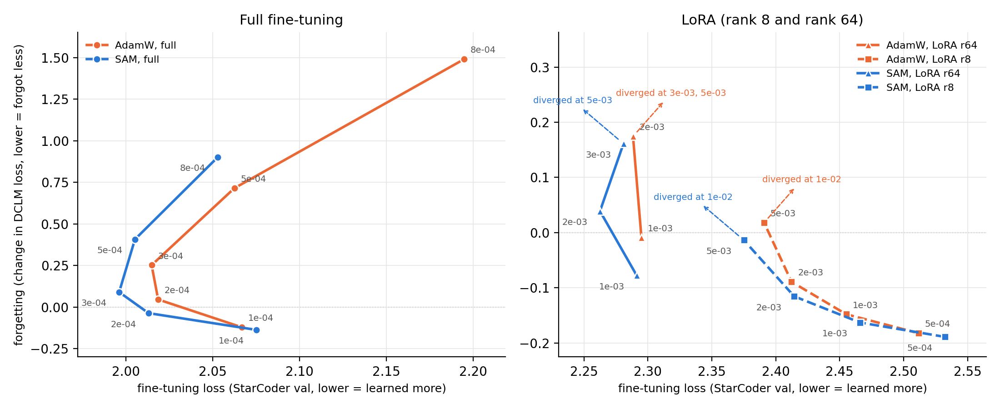
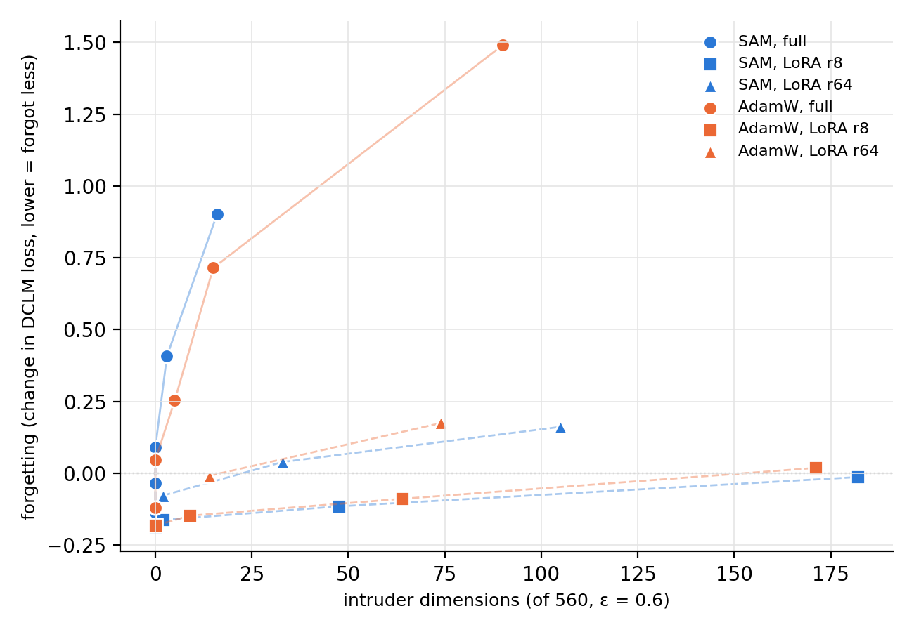

# LoRA Forgetting and Sharpness-Aware Pretraining

Tests whether models pretrained with sharpness-aware minimization (SAM) forget less after LoRA fine-tuning, and whether that happens through fewer intruder dimensions or through flatter curvature along them. Building on Watts et al. (2026), *Sharpness-Aware Pretraining Mitigates Catastrophic Forgetting*, and Shuttleworth et al. (2025), *LoRA vs Full Fine-tuning: An Illusion of Equivalence*,
I explore:
1. **Does SAM pretraining reduce forgetting after LoRA?**
    - Watts et al. show SAM pretraining reduces forgetting after full finetuning.
    - Does that result hold for LoRA (rank 8 and 64) on the same SAM/AdamW checkpoints and data?
      - Compare at matched finetuning loss, with full finetuning across the same learning rates as reference
2. **Does SAM pretraining change intruder dimensions?**
    - Do LoRA updates on SAM pretrained weight matrices create fewer or weaker intruder dimensions?
3. **Are SAM's intruders in flatter directions?**
    - For SAM and AdamW, compare curvature of the pretraining loss along each intruder direction (with Hessian-vector products) and compare with random directions.
4. **What mechanisms impact forgetting?**
    - less or weaker intruders, the same intruders in flatter directions, both?
### Central Hypothesis:

The forgetting caused by an intruder dimension grows with the curvature of the pretraining loss along its direction.

---
### Setup Guides

<details>
    
<summary><b>Local Setup (development)</b></summary>

- (Python 3.10)
#### Install Dependencies
```bash
python -m venv .venv
source .venv/bin/activate
pip install -r requirements.txt
hf auth login
```
Login to Hugging Face + Accept Terms for the [StarCoder dataset](https://huggingface.co/datasets/bigcode/starcoderdata).
#### Download Model Checkpoints
Raw OLMo 60M SAM and AdamW checkpoints from Watts et al.
```bash
hf download WattsIshaan/OLMo-60m-192B-sam-cosine config.yaml model.pt --local-dir checkpoints/olmo-60m-sam
hf download WattsIshaan/OLMo-60m-192B-adamw-cosine config.yaml model.pt --local-dir checkpoints/olmo-60m-adamw
```
(Experiments convert to `transformers` Llama models)
#### Build Tiny Data
Tokenize Hugging Face data with `allenai/dolma2-tokenizer` (same as Watts et al.) and save 1024-token rows to `data/` as numpy files with JSON descriptions.
```bash
# held-out DCLM tokens from random files for measuring forgetting
python -m scripts.make_dclm_heldout --tokens 20000 --files 2 --out data/dclm_tiny.npy

# tokens of StarCoder Python for finetuning
python -m scripts.make_starcoder --train-tokens 20000 --val-tokens 5000 --out-dir data/tiny
```
#### Run tests
```bash
python -m pytest -v
```

</details>

---

<details>

<summary><b>Reproduce Results on Cluster</b></summary>

- NYU HPC Cloud Bursting.
- Start a CPU session (`n2c48m24`) on [Open OnDemand](https://ood.burst.hpc.nyu.edu/) and open a terminal.

<blockquote>

<details>

<summary><b>First Time Setup</b></summary>

#### Get the Code
```bash
ssh-keygen -t ed25519 -f ~/.ssh/id_ed25519 && cat ~/.ssh/id_ed25519.pub   # add to GitHub: Settings -> SSH keys
git clone git@github.com:jni2003/lora-sam-forgetting.git && cd lora-sam-forgetting
```
#### Install Env
Python runs inside a Singularity container, with packages in an overlay file. The image is set in `scripts/slurm/run_in_env.sh`.
```bash
cp /share/apps/overlay-fs-ext3/overlay-15GB-500K.ext3.gz ~/lora-env.ext3.gz && gunzip ~/lora-env.ext3.gz
singularity exec --overlay ~/lora-env.ext3:rw /scratch/work/public/singularity/cuda12.6.3-cudnn9.5.1-ubuntu22.04.5.sif /bin/bash
# inside the container:
wget https://github.com/conda-forge/miniforge/releases/latest/download/Miniforge3-Linux-x86_64.sh
bash Miniforge3-Linux-x86_64.sh -b -p /ext3/miniforge3
printf 'unset -f which\nsource /ext3/miniforge3/etc/profile.d/conda.sh\nexport PATH=/ext3/miniforge3/bin:$PATH\nconda activate lora\n' > /ext3/env.sh
source /ext3/miniforge3/etc/profile.d/conda.sh && conda create -y -n lora python=3.10
source /ext3/env.sh && pip install -r requirements.txt && hf auth login
exit
```
#### Download Checkpoints and Build Data (one-time, CPU job)
```bash
sbatch scripts/slurm/prepare.sbatch
```

</details>

<details>

<summary><b>Run Experiments</b></summary>

```bash
sbatch scripts/slurm/eval_base.sbatch               # base-model losses
sbatch scripts/slurm/finetune.sbatch sam 5e-4       # one run: BASE LR [LORA_RANK] [SEED]
sbatch scripts/slurm/finetune.sbatch adamw 5e-4 8   # e.g. LoRA rank 8
sbatch --account=csci_ga_3033-134-2026fa --partition=n2c48m24 --mem=16G --time=00:30:00 --job-name=intruders --output=slurm-%x-%j.out --wrap "bash scripts/slurm/run_in_env.sh python -m scripts.countIntruders --runs checkpoints/finetuned/*"   # intruder counts (CPU)
bash scripts/slurm/run_in_env.sh python -m scripts.plot_forgetting --panels --out results/forgetting_panels.png
squeue --me                                         # check jobs; scancel <JOB_ID> to cancel
python -m scripts.plotIntruders --eps 0.6 --out results/intruders_vs_forgetting.png    # intruder count vs forgetting plot
```
End the session under **My Interactive Sessions** when done (closing the tab doesn't end it).

</details>

</blockquote>

</details>

---

### Current Results (preliminary, Nov 16 2026)

60M SAM/AdamW pair from Watts et al., fine-tuned on 10M tokens of StarCoder Python. Forgetting = change in held-out DCLM loss.



Higher = more forgetting (increase in held-out DCLM loss). Runs are compared at equal StarCoder loss, so less forgetting can't come from learning less.
- **Full finetuning:** SAM forgets less than AdamW at every learning rate (1e-4 to 8e-4), reproducing Watts et al.
- **LoRA rank 8:** SAM forgets only slightly less (0.02–0.03, reproduced on a second seed); rank 8 learns much less than full finetuning.
- **LoRA rank 64:** SAM forgets clearly less (0.07–0.14) and forms about half as many intruder dimensions at learning rate 2e-3. AdamW diverged at learning rate 3e-3 where SAM trained normally.
- **Not yet tested:** curvature along intruders (whether the remaining intruders sit in flatter directions).

**Forgetting vs intruder counts**


For each finetuning method, runs with more intruders forget more, but intruder count doesn't predict forgetting across methods.

Result files are in [`results/`](results/): one JSON/run, base model evaluations, and intruder counts (`intruders.json`).

---

### Joel Indurkar
### Science of Deep Learning (CSCI-GA.3033)
### NYU Courant - Fall 2026
